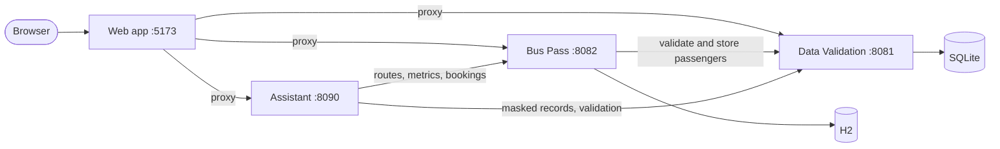

# Cloud Smart Services


**Three independent services for duplicate detection, bus ticketing and retrieval-based chat, with one unified dashboard.**

This project started as Tasks 1, 3 and 4 of the CodeAlpha Cloud Computing Internship (1–30 March 2026). It has since been refactored into a single platform: each service still runs on its own, and together they work as one application. It runs locally as a demonstration of cloud-style service design, and is not deployed to a cloud provider.

## Table of Contents

- [Project Overview](#project-overview)
- [Key Features](#key-features)
- [Tech Stack](#tech-stack)
- [System Architecture](#system-architecture)
- [Project Structure](#project-structure)
- [Getting Started](#getting-started)
- [Usage](#usage)
- [Testing](#testing)
- [Known Limitations](#known-limitations)
- [Future Improvements](#future-improvements)
- [Contributors](#contributors)
- [License](#license)

## Project Overview

**Problem:** Booking systems need trustworthy tickets and prices, customer records drift into duplicates, and users want quick answers from both.

**Solution:** A bus pass service issues signed tickets, a validation service rejects duplicates before they are stored, and an assistant answers questions using fixed rules and live data from both. A shared dashboard brings them together, and each service keeps working if another goes down.

| Task | Service | Port | Purpose |
| --- | --- | --- | --- |
| 1 | [Data Validation](services/data-redundancy) | `8081` | Duplicate detection and record storage |
| 3 | [Bus Pass](services/bus-pass) | `8082` | Pricing, booking and ticket verification |
| 4 | [Assistant](services/chatbot) | `8090` | Retrieval-based chatbot |
| | [Web app](apps/web) | `5173` | Unified dashboard |

## Key Features

- **Two ways to run:** Start any service alone, or start everything and use the shared dashboard.
- **Duplicate prevention:** Records are normalised and fingerprinted, so formatting cannot hide a duplicate, including under concurrent requests.
- **Validated bookings:** Bus Pass checks each passenger with Data Validation, and only stores them once their ticket exists.
- **Visible failure handling:** If Data Validation is down, tickets are issued as `PENDING` and checked automatically when it returns.
- **Tamper-evident tickets:** Tickets carry HMAC signatures, so a changed fare, email or travel date fails verification.
- **Reliable seats:** Seats are assigned under a database lock and stay correct across restarts.
- **Protected personal data:** Bookings need the ticket number and email, and public record lists are masked.
- **Retrieval-based assistant:** Answers come from predefined rules and live lookups, each labelled by source. It uses no machine learning model.

## Tech Stack

| Layer | Technologies | Purpose |
| --- | --- | --- |
| Frontend | React, TypeScript, Vite, React Router | Unified dashboard and same-origin proxy |
| Backend | Java 21, Spring Boot 4.0.4, JDK `HttpServer` | REST APIs and chatbot server |
| Data | SQLite, H2, Spring Data JPA | Records (SQLite) and tickets (H2) |
| Integration | REST, JSON, Java `HttpClient` | Communication between services |
| Testing | JUnit, Mockito, Vitest, Testing Library, Node.js | Unit, API, UI and integration tests |

## System Architecture



### Notable Design Decisions

- **Separate data stores:** Each service owns its data and shares it through its API, at the cost of holding some passenger details twice.
- **No shared library:** The services share contracts rather than code, so each can change and deploy on its own.
- **Availability with visibility:** A Data Validation outage does not block bookings, but those tickets stay `PENDING` until they are checked.
- **Same-origin proxy:** The browser only talks to the web app, so services need no CORS and their addresses stay private.

More detail is in [`docs/architecture.md`](docs/architecture.md), and every endpoint is in [`docs/api-integration.md`](docs/api-integration.md).

## Project Structure

```text
codealpha_tasks/
├── apps/web/                  # Unified React dashboard
├── services/
│   ├── data-redundancy/       # Task 1: Spring Boot and SQLite
│   ├── bus-pass/              # Task 3: Spring Boot and H2
│   └── chatbot/               # Task 4: JDK HTTP server
├── scripts/                   # Start-all and integration test scripts
├── docs/                      # Architecture, API and development guides
└── INTEGRATION_CHECKLIST.md   # Manual end-to-end checks
```

## Getting Started

### Prerequisites

- Java 21 or later
- Node.js 22.12 or later, or Node.js 24

Maven does not need to be installed, because each service includes the Maven Wrapper.

### Start everything

```bash
git clone https://github.com/Anj-13/codealpha_tasks.git
cd codealpha_tasks
node scripts/start-all.mjs
```

The first run builds the services and installs the web app's packages, which takes a few minutes. Then open <http://localhost:5173>. Press `Ctrl+C` to stop everything.

### Start one service

Each service runs alone. For example, for Bus Pass on Windows:

```cmd
cd services\bus-pass
.\mvnw.cmd -DskipTests package
java -jar target\buspass-0.0.1-SNAPSHOT.jar
```

Commands for every service and all configuration options are in [`docs/development.md`](docs/development.md). No configuration is needed for local use.

## Usage

Use the dashboard to validate records, book and find tickets, and talk to the Assistant. Try `show routes`, `what are the fares` or `how does validation work`.

To book a ticket through the API:

```cmd
curl -X POST http://localhost:8082/api/buspass/tickets/book -H "Content-Type: application/json" -d "{\"passengerName\":\"Demo User\",\"email\":\"demo.user@example.com\",\"phone\":\"07000 100 001\",\"routeCode\":\"R-100\",\"travelDate\":\"2030-01-15\",\"passengerCategory\":\"ADULT\"}"
```

## Testing

```bash
node scripts/integration-test.mjs --rebuild
```

This runs the real services on spare ports with throwaway databases, then checks how they work together, including concurrent requests, outages, recovery and restarts. Each service and the web app also have their own tests, listed in [`docs/development.md`](docs/development.md#testing).

## Known Limitations

- **Local only:** It is not deployed to a cloud provider, and there is no Docker setup.
- **Scaling is advisory:** The server count is a recommendation, and nothing is provisioned. It counts all bookings ever made, so it never falls.
- **No user accounts:** Booking access relies on the ticket number and email, and admin access on one shared key. There is no rate limiting.
- **Record checks reveal matches:** The validate endpoint shows whether an email or phone number is already known.
- **No review workflow:** Records flagged for review wait there, with no screen to resolve them.
- **No QR image or cancellation:** Tickets carry a QR token, but no image is generated, and bookings cannot be cancelled online.
- **Development proxy:** The web app's proxy is the Vite server. A real deployment needs a proper reverse proxy, and the services need to be kept off public networks.
- **Older tickets:** Tickets issued before signing was added cannot be verified, and report `LEGACY_UNSIGNED`.

## Future Improvements

- [ ] Deploy to a cloud provider with real autoscaling.
- [ ] Add Docker images and Compose.
- [ ] Add user accounts and rate limiting.
- [ ] Add a review screen for flagged records.
- [ ] Add ticket cancellation and QR images.
- [ ] Base scaling advice on current traffic.

## Contributors

Developed by [Anj-13](https://github.com/Anj-13).

## License

No license has been specified.
