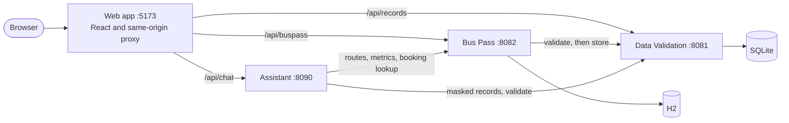
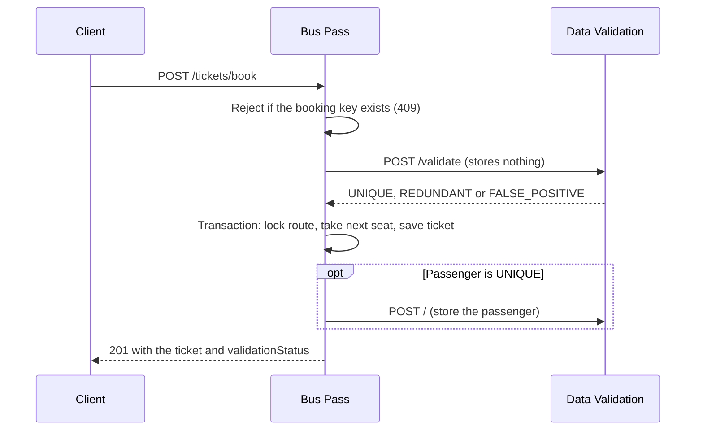

# Architecture

Cloud Smart Services is three independent services and one web app. Each service has its own build, port and data store, and shares data only through its HTTP API. There is no shared library, because shared code would tie the services' releases together.

Dependencies only point one way, so there are no cycles: the Assistant calls Bus Pass and Data Validation, Bus Pass calls Data Validation, and Data Validation calls nothing.

## Why a proxy

The browser only talks to the web app's origin, which forwards each path to the right service. The services therefore send no CORS headers, and their addresses never reach the browser. The proxy is the Vite server, which suits local use. A real deployment would put a reverse proxy in the same position.

## Booking flow

A booking crosses two services, so the order matters.

- **Calls stay outside the transaction.** A slow service cannot hold a database lock open.
- **The passenger is stored after the ticket commits.** A failed booking cannot leave a passenger with no ticket.

## Failure policy

Task 3 never issues a ticket that silently skipped its duplicate check. It issues the ticket and records how far the check got.

| `validationStatus` | Meaning | What happens next |
| --- | --- | --- |
| `VERIFIED` | The passenger is stored in Task 1 | Nothing |
| `PENDING` | Task 1 could not be reached, or the store step failed | A background job retries until it gets an answer |
| `REVIEW` | Details partly match another record, or Task 1 refused them | Held for a person to check |
| `NOT_CHECKED` | The integration is off, or the ticket predates validation | Nothing |

The stricter option, refusing to book with `503`, would protect the data better but make Task 1 a single point of failure for bookings. The visible `PENDING` state was chosen instead.

| Offline | Effect |
| --- | --- |
| Data Validation | Bookings continue as `PENDING`. The Assistant says it cannot read records. |
| Bus Pass | Booking pages show an offline notice. The Assistant still gives its fixed answers. |
| Assistant | Only the Assistant page is affected. |
| Web app | Every service still works through its own API. |

## Data integrity

| Risk | Protection |
| --- | --- |
| Duplicate customer records | SQLite allows one writer, so a pool of one connection runs each check and insert in turn. A unique fingerprint constraint backs this up. |
| Duplicate bookings | A SHA-256 `bookingKey` of the normalised email, name, route and date has a unique constraint. The early check only saves a call to Task 1. |
| Repeated seats | The route row is locked while the next seat is taken from the database, so seats survive restarts. |
| Forged tickets | The checksum and QR token are HMAC-SHA256 signatures. The key lives outside the database, so editing a row is not enough. |

There is deliberately no unique constraint on seats. The old in-memory counter left repeated seats in existing data, and such a constraint would fail against it.

Existing rows are not rewritten. New columns are nullable, so tickets from before this design keep working. They are reported as `NOT_CHECKED`, and verification returns `LEGACY_UNSIGNED` rather than trusting a checksum that was never signed.

## Access control

There are no user accounts.

- **Bookings:** reading one needs the ticket number and the booking email. A wrong email gets the same `404` as a wrong number, so neither can be probed. The email goes in a POST body to keep it out of URLs and logs.
- **Ticket verification:** public, because it only returns `valid` and a reason.
- **Records:** masked by default. `X-Admin-Key` returns full records and must match `ADMIN_API_KEY`. With no key configured, every admin request is refused.

## Assistant

The Assistant is retrieval-based and uses no machine learning model. A message goes through three steps:

1. `IntentService` tests an ordered list of regular expressions, with word boundaries, so `hi` no longer matches inside "which". Specific questions come first and greetings last.
2. `MessageDetails` pulls any ticket number, email, phone and name out of the message.
3. `ChatService` answers from `StaticResponses`, or from a live lookup in `ExternalKnowledgeService`.

Each reply carries `source: STATIC` or `LIVE`. Live lookups catch their own failures and answer in plain text, so an outage never surfaces as an error.

## Why H2 enums are stored as text

Ticket enums use `@JdbcTypeCode(SqlTypes.VARCHAR)`. Mapped as native H2 `ENUM` columns, they broke after a restart followed by a write: H2 returned ordinals such as `3`, and queries on those columns failed. The integration test's restart step caught this.
